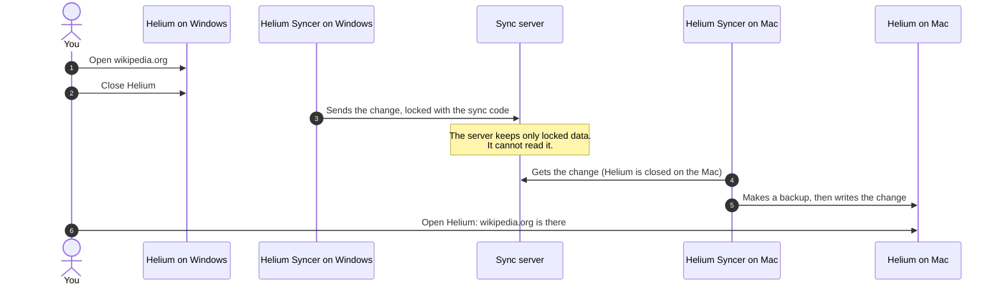
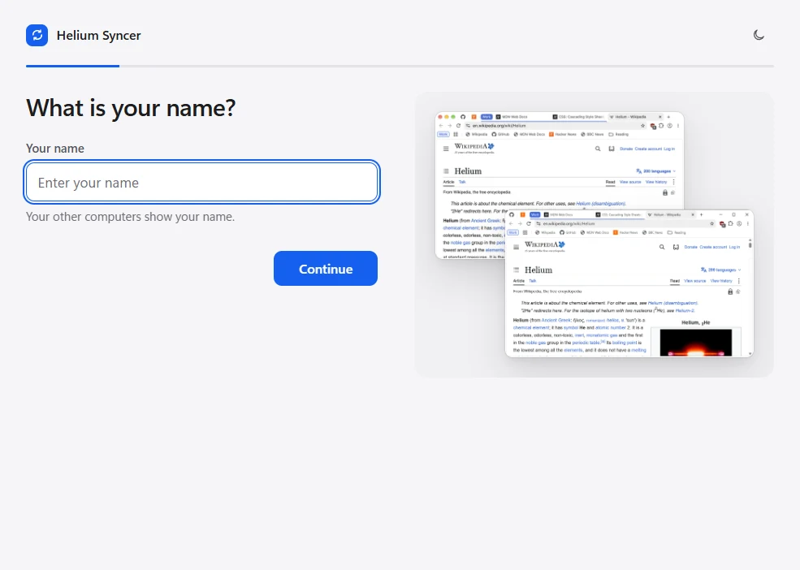
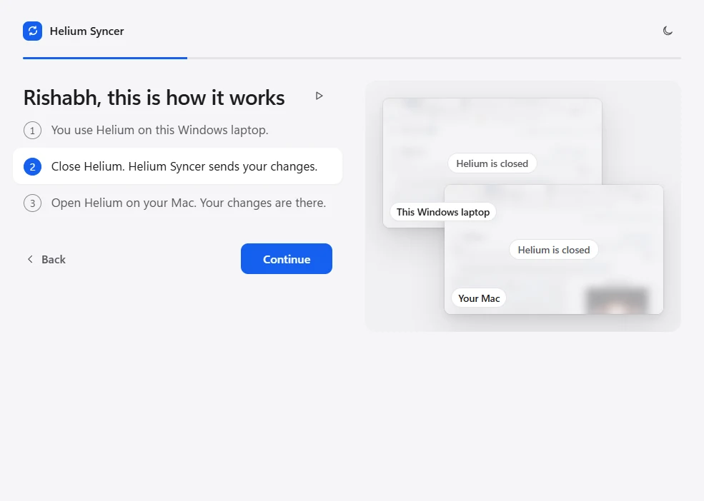
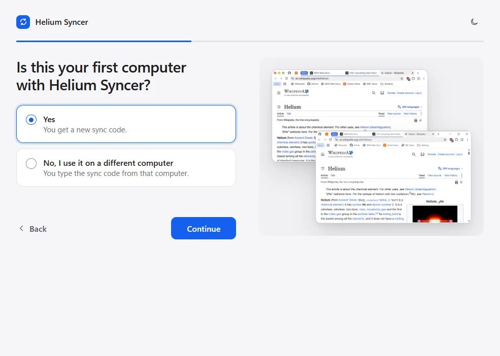
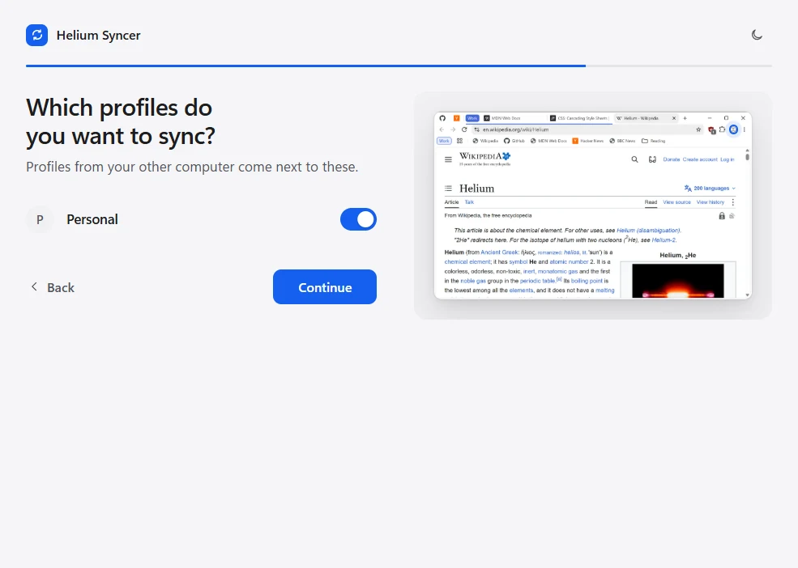
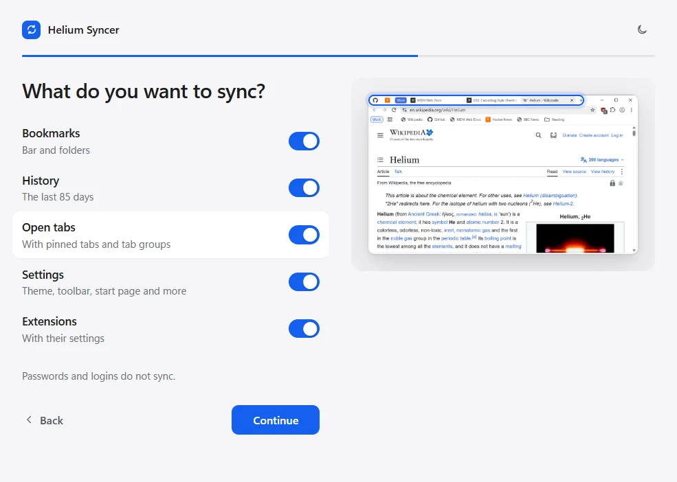
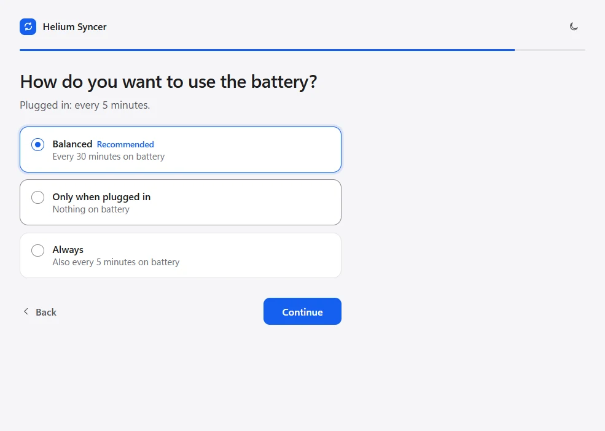
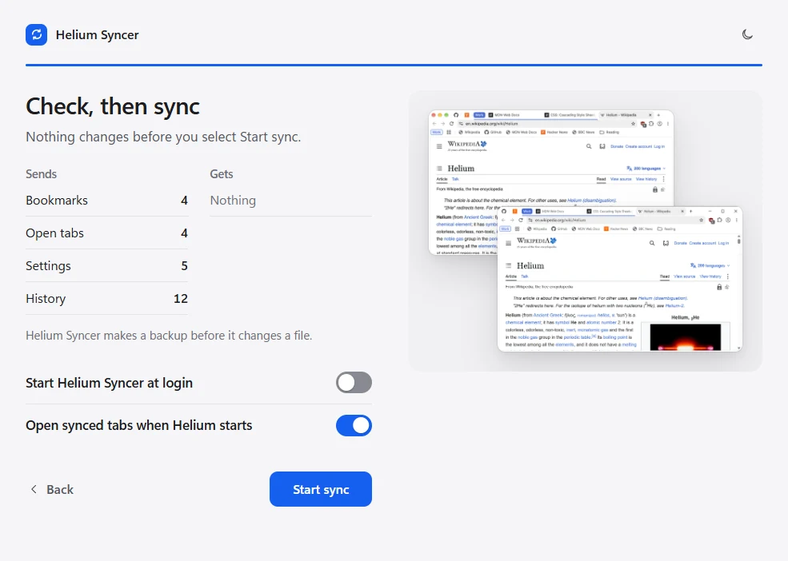
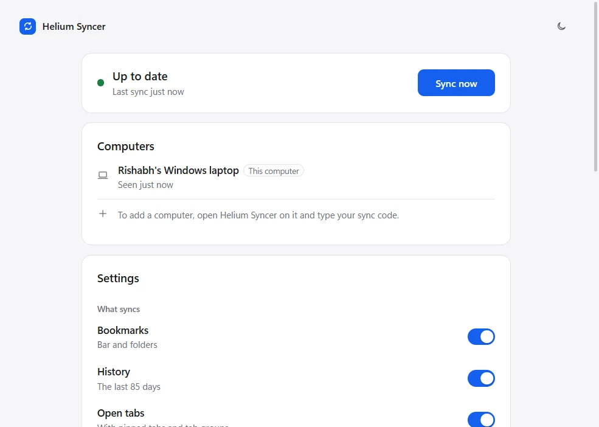

# Helium Syncer

**Use the same Helium browser on your Mac and your Windows computer.**
Your bookmarks, open tabs, tab groups, profiles, settings and extensions sync between your computers. Bookmarks and open tabs also sync while you use Helium.

> [!IMPORTANT]
> **Helium Syncer is not part of the [Helium](https://helium.computer) browser project.**
> The Helium team and imput did not make it. They do not support it and they do not pay for it.
> Helium Syncer is a free hobby project. It helps people who use Helium on more than one computer.
> We use the name "Helium" only to tell you which browser this tool works with.

> [!WARNING]
> **Early version. Do not use it for important data yet.**
> It works between a real Mac and a real Windows computer, and the tests pass. But there is no download yet: to try it now, [build it yourself](#build-it-yourself). Watch or star this repository to see when it is ready.

---

## Contents

- [How it works](#how-it-works)
- [See it](#see-it)
- [What syncs](#what-syncs)
- [The helper extension](#the-helper-extension)
- [Set it up](#set-it-up)
- [Battery and speed](#battery-and-speed)
- [What you need](#what-you-need)
- [Your data is safe](#your-data-is-safe)
- [Privacy](#privacy)
- [Questions](#questions)
- [Build it yourself](#build-it-yourself)
- [Roadmap](#roadmap)
- [A short note from me](#a-short-note-from-me)

---

## How it works

**An example.** You have a Windows laptop at work and a Mac at home.

1. At work, you open `wikipedia.org` in Helium.
2. You close Helium. Helium Syncer locks the change with your sync code and sends it.
3. At home, Helium is closed. Helium Syncer on the Mac gets the change and writes it into Helium.
4. You open Helium on the Mac. `wikipedia.org` is open there too.



**While Helium is open on both computers**, bookmarks and open tabs sync too:

1. On Windows, you open `wikipedia.org` in a new tab.
2. A few seconds later, the tab opens in Helium on your Mac.
3. You close the tab on the Mac. It closes on Windows too.

This works through a small [helper extension](#the-helper-extension) that Helium Syncer adds to Helium. Helium Syncer asks Helium to make the change. It does not change Helium's files while Helium is open. On a laptop on battery, these changes wait and travel together, at most every 5 minutes (see [Battery and speed](#battery-and-speed)).

**Three rules that never change:**

- Helium Syncer **never writes Helium's files while Helium is open**. Everything other than bookmarks and open tabs waits until you close Helium.
- Helium Syncer **never deletes your data**. Profiles from your other computer come next to your profiles.
- Before each change to Helium's files, Helium Syncer **makes a backup**.

On a Mac, "close Helium" means **Command + Q**. A closed window is not enough.

## See it

The setup takes a few minutes. These are the real screens of the app window, with test data. The pictures inside them are real Helium windows.

<table>
<tr><td valign="top"><br>1. Type your name.</td><td valign="top"><br>2. See how it works, in 3 steps.</td></tr>
<tr><td valign="top"><br>3. Start a new sync, or join one.</td><td valign="top"><br>4. Select your profiles.</td></tr>
<tr><td valign="top"><br>5. Select what syncs. The real Helium window shows each item.</td><td valign="top"><br>6. On a laptop, select a battery mode.</td></tr>
<tr><td valign="top"><br>7. Check what changes. Nothing changes before you agree.</td><td valign="top"><br>8. Home: status, computers and settings.</td></tr>
</table>

## What syncs

You can switch each item on or off, on each computer.

| Item | What happens |
|---|---|
| **Bookmarks** | The bookmarks bar and all folders. A bookmark that you delete on one computer is deleted on the other. Also while Helium is open. |
| **Open tabs** | Open tabs, pinned tabs, tab groups and Helium pages such as Extensions (not the new tab page). Helium Syncer puts them together without copies. A tab that you close closes on your other computer too. Also while Helium is open. |
| **History** | **Off on a new computer**, because it is most of the data and of the work. Switch it on in setup or in **Settings** if you want it: pages that you opened in the last 85 days, from all your computers. |
| **Settings** | Start page, toolbar, theme, fonts, languages and privacy switches. Not the download folder or window sizes. |
| **Extensions** | Helium Syncer installs your extensions on the other computer, with their settings (for example, your blocker rules). |
| **Profiles** | Always on. A profile from your other computer is added next to your profiles. If two profiles have the same name, the new one gets a number, for example "Personal (2)", on this computer only. |

**What does not sync:**

| Item | Why |
|---|---|
| Passwords | Use a password manager, for example 1Password or Bitwarden. |
| Site logins (cookies) | Not yet. A later version adds this, only for sites that you select. Google, Microsoft, Apple and bank sites stay locked, because a login that moves can lock your account. |

## The helper extension

Helium keeps your bookmarks and tabs in memory while it is open, so no outside program can change them safely. To sync them while you use Helium, Helium Syncer adds a small extension, **Helium Syncer**, to each synced profile. It does this by itself, after you close Helium. You do not need to install anything.

- **It talks only to Helium Syncer on the same computer** (the address `127.0.0.1`). It never connects to the internet. Helium Syncer locks the data before it sends it to your other computer.
- **What it can see:** your bookmarks and the addresses of your open tabs. It needs these to sync them. It cannot see passwords, cookies or what you type on pages.
- **Developer mode.** Helium runs an extension that is not from the Chrome Web Store only when **Developer mode** is on. Helium Syncer switches it on in each synced profile. You can see it on Helium's Extensions page.
- **Only Helium Syncer can use it.** Helium Syncer accepts a connection only from this extension. A website cannot connect.
- **The code is open:** [`extension/`](extension).

## Set it up

> [!NOTE]
> There is no download yet. To try Helium Syncer now, [build it yourself](#build-it-yourself).

**On your first computer:**

1. Install [Helium](https://helium.computer). Open Helium one time. Then close Helium.
2. Open **Helium Syncer**. It opens in its own window.
3. Type your name. Helium Syncer shows how it works in 3 steps.
4. Select **Yes**. Save your **sync code** in your password manager.
5. Select what you want to sync and which profiles.
6. Read the check. Nothing changes before you select **Start sync**.

**On each other computer:**

1. Install Helium and Helium Syncer.
2. Open Helium Syncer. Type your name.
3. Select **No, I use it on a different computer**. Type your sync code.
4. Read the check. Then select **Start sync**.

Each step has a **Back** button.

Helium Syncer adds the [helper extension](#the-helper-extension) at its first sync while Helium is closed. If Helium was open, it does this after you next close Helium. From then on, bookmarks and tabs also sync while Helium is open.

After this, Helium Syncer works by itself. It shows an icon next to the clock (Windows) or in the menu bar (Mac):

| Icon | Meaning |
|---|---|
| 🔵 Blue | All is good. |
| 🟠 Orange | Helium Syncer needs you. Open its menu to see why. |

## Battery and speed

Helium Syncer does very little while it waits. Measured on 11 November 2026 on two real computers that sync about 600 bookmarks, 12 extensions and 30 tabs:

| | Processor | Memory |
|---|---|---|
| Windows desktop, Helium open, syncing live | **1.2 seconds in 12 minutes** (0.16 %) | 5 MB |
| MacBook Air, Helium open, syncing live | **1.7 seconds in 12 minutes** (0.22 %) | 44 MB |

The Mac number is what macOS charges the app; a tool like Activity Monitor shows about 100 MB, because it counts the shared Apple frameworks that every program on the Mac loads.

> [!NOTE]
> An earlier version of this page said the Mac used "about 0.07 seconds in 5 minutes". That was wrong. Measured again on 11 November 2026, a sync with nothing to do spent 4.3 seconds in the extensions step alone, because it packed and compressed every extension's saved data just to find out whether any of it had changed. Measured on that Mac's own profile, packing takes **498 ms** and looking at the name, size and change time of the same files takes **0.4 ms**. A sync does it twice, so the cost per sync fell from about a second to under a millisecond; the rest of the 4.3 seconds was an extension that was reported as changed on every sync, fixed the same day.

**While Helium is open** (bookmarks and open tabs):

| | Plugged in (or a desktop) | On battery |
|---|---|---|
| A change on your other computer | Arrives in a few seconds. The server tells Helium Syncer, so it does not need to ask again and again. | Waits, and arrives with other changes, at most every 5 minutes. |
| A change on this computer | Leaves in a few seconds. | Waits, and leaves with other changes, at most every 5 minutes. |
| Contact with the server | One quiet connection, with a very small signal every 4.5 minutes. | No open connection. One small check every 5 minutes. |

We measured about 7 seconds from a new tab on one computer to the same tab on the other, both plugged in. On battery, changes travel together: for example, 20 tab changes in 5 minutes make one sync, not 20.

**While Helium is closed**, you select how Helium Syncer uses the battery:

| Mode | Plugged in | On battery | Low battery (20 % or less) or battery saver |
|---|---|---|---|
| **Balanced** (recommended) | A check every 5 minutes | A check every 30 minutes | Only one sync after you close Helium |
| **Only when plugged in** | A check every 5 minutes | Nothing. Your changes wait. | Nothing |
| **Always** | A check every 5 minutes | A check every 5 minutes | A check every 5 minutes |

In all modes:

- **Sync now** always works.
- A sync runs at low priority, so your computer stays quiet. On Windows, Helium Syncer also uses the Windows efficiency mode.
- To know if Helium is open, Helium Syncer does one small file check every 5 seconds (every 15 seconds on battery).

## What you need

| | Windows | Mac |
|---|---|---|
| **System** | Windows 10 or Windows 11 | macOS 12 Monterey or newer |
| **Processor** | 64-bit Intel or AMD, or ARM | Apple silicon (M1 and newer) or Intel |
| **Memory** | 4 GB or more (Helium Syncer uses about 21 MB) | 4 GB or more |
| **Helium** | Any install type: for you only or for all users | Any folder, for example Applications |
| **Other software** | **None.** No PowerShell version, no admin rights, no extra installs. | **None.** No Homebrew, no admin rights. |

Helium Syncer is one program with everything inside it. It finds Helium by itself. If Helium is in an unusual place, the window lets you select the Helium data folder.

If Helium is not installed, the window tells you. It gives you a button to get Helium.

## Your data is safe

- **A backup before each change.** If a sync stops in the middle (for example, a power cut), the next start puts everything back.
- **Never Helium's files while Helium is open.** Helium Syncer checks again before each write. While Helium is open, only bookmarks and tabs change, and only through Helium itself (the [helper extension](#the-helper-extension)).
- **Safe with tabs.** If Helium is open with no window (on a Mac, after you close the last window), or if Helium is still starting, no tab closes on your other computer. If Helium brings back an older copy of your tabs when it starts, a tab that you closed on the other computer does not come back.
- **A check before the first sync.** You see what will change. Nothing changes before you agree.
- **Helium updates.** Sync goes on after a Helium update. Before Helium Syncer writes a file, it checks that it still understands how Helium stored it: it re-computes Helium's own signature on the settings and the checksum of the bookmarks. If one does not match, only that item waits, and the app tells you; everything else syncs on. Every day, GitHub runs all the real-Helium tests on the newest Helium release.
- **Tested.** 128 automatic tests, with many random cases. Many use a real Helium browser on Windows and macOS, also two Helium browsers open at the same time. We also break the code on purpose to make sure that the tests find the problem.

## Privacy

- **Locked on your computer.** Helium Syncer locks (encrypts) your data before it leaves your computer. The server keeps only locked data. Nobody else can read it. We also cannot.
- **No account.** There is no email and no password. Your sync code is the only key. The server never gets the code.
- **Keep your sync code safe.** A person with your code can join your sync. If you lose the code, nobody can get it back for you.
- **What the server knows:** your computer names, your Helium versions, the size of your locked data, and when a computer is connected. It does not know what changed.
- **The helper extension** sends nothing to the internet. It talks only to Helium Syncer on the same computer.
- **No tracking.** The app sends nothing else. It uses no web fonts and no analytics.
- **Self-hosting.** You can run the server on your own Cloudflare account.
- **Open source.** All the code is in this repository, under the MIT license.

## Questions

**How do I know it is working?**

Look at the Helium Syncer icon: in the Windows tray, in the macOS menu bar. It tells you in words what is happening right now.

| What it says | What it means |
|---|---|
| Syncing while Helium is open | Bookmarks and open tabs are syncing this second. Everything else waits for you to close Helium |
| Syncs after you quit Helium | The helper extension is not connected yet. It is added the next time you close Helium |
| Up to date · synced 5 minutes ago | Nothing is waiting |
| Battery is low: syncs when you plug in | Your changes still go out; changes from your other computer arrive when you plug in |
| On battery: syncs when you plug in | You chose "only when plugged in" in Settings |
| Problem syncing · open Helium Syncer | Open the window: it says what went wrong |

**I lost my sync code. What do I do?**
On a computer that still syncs, open Helium Syncer. Go to **Settings**. Select **Show** next to **Sync code**.

**Both computers have Helium open. What happens?**
Bookmarks and open tabs sync between them through the [helper extension](#the-helper-extension): in a few seconds when plugged in, at most every 5 minutes on battery. Everything else waits until you close Helium.

**I closed a tab on one computer. Does it come back?**
No. A tab that you close closes on all your computers.

**Why is Developer mode on in Helium?**
Helium runs the [helper extension](#the-helper-extension) only when Developer mode is on, because the extension is not from the Chrome Web Store.

**Why does a page that I did not open appear in a tab?**
You opened it on your other computer. Open tabs sync between your computers.

**Can I stop syncing on one computer?**
Yes. Go to **Settings** and select **Leave**. Your Helium data stays on that computer.

**What starts it, and what if it stops?**

It starts when you log in, and starts again by itself if it ever stops - a crash, or another program taking it down with it.

| | How it starts | If it stops |
|---|---|---|
| Mac | A LaunchAgent, `~/Library/LaunchAgents/com.aiwithrishabh.helium-syncer.plist` | Back in about 3 seconds |
| Windows | A scheduled task named **Helium Syncer** | Back within a minute |

Neither needs an administrator, and neither shows a window. On Windows the task also tells Windows **not** to stop it when a laptop is unplugged, which Windows otherwise does to scheduled tasks by default.

**How do I remove Helium Syncer?**
1. In Helium Syncer, go to **Settings** and select **Leave**. This also takes away the LaunchAgent or the scheduled task.
2. Quit Helium Syncer from its icon menu.
3. Delete the app.
4. In Helium, open the Extensions page. Remove **Helium Syncer**. If you use no other extension from outside the Web Store, switch off **Developer mode**.
5. Optional: delete its folder. Windows: `%APPDATA%\Helium Syncer`. Mac: `~/Library/Application Support/Helium Syncer`.

Your Helium data stays as it is.

**Does Helium Syncer read my passwords?**
No. Helium Syncer does not read or sync passwords.

## Build it yourself

You need [Go](https://go.dev/dl/). The build scripts get the correct Go version (1.26.10) by themselves. Go 1.26 makes programs that run on macOS 12 and Windows 10.

**Mac** (you also need the Xcode command line tools: `xcode-select --install`):

```bash
sh scripts/build-app.sh
```

This makes `bin/Helium Syncer.app`. It works on Apple silicon and Intel Macs.

**Windows** (works with Windows PowerShell 5.1 and PowerShell 7):

```powershell
powershell -ExecutionPolicy Bypass -File scripts/build-app.ps1
```

This makes `bin\Helium Syncer.exe` (64-bit Intel and AMD) and `bin\arm64\Helium Syncer.exe` (ARM).

There is also a command-line tool for advanced users. Type `helium-syncer help` to see its commands.

**Help with tests.** Do you have Helium on a Mac or a Windows computer? These scripts show where Helium keeps its data. They do not show secrets and they do not change Helium. They save a short report on your Desktop and copy it, so that you can send it to us.

```bash
curl -fsSL https://raw.githubusercontent.com/imrishabhchauhan/helium-syncer/main/scripts/check-mac.sh | bash
```

```powershell
irm https://raw.githubusercontent.com/imrishabhchauhan/helium-syncer/main/scripts/check-windows.ps1 | iex
```

## Roadmap

- [x] **Step 0:** Read and write each Helium data type safely, on test profiles (Windows and macOS).
- [x] **Step 1:** Sync code, encryption, server, profiles, bookmarks, history, tabs, pinned tabs, tab groups, settings, extensions.
- [x] **Step 2:** Setup window, tray and menu-bar app, battery modes, on/off switch for each item.
- [x] **Step 3:** Real tests between a Mac and a Windows computer.
- [x] **Step 3b:** Bookmarks and open tabs sync while Helium is open (helper extension), with battery care on laptops.
- [ ] **Step 4:** Site logins, only for sites that you select.
- [ ] **Step 5:** Downloads, signed installers, automatic updates, quicker support for new Helium versions, and a self-hosting guide. *(next; plan in [docs/03-release-plan.md](docs/03-release-plan.md))*

The full design is in [docs/01-spec.md](docs/01-spec.md).

## A short note from me

I love the official Helium browser. It is fast, simple and private. It is the browser that I want to use each day.

Helium does not have sync yet. I work on a Mac and on a Windows computer, so for my work I need sync. So I made this tool with [Claude Code](https://claude.com/claude-code) 🙂

When the Helium team adds sync ([imputnet/helium#90](https://github.com/imputnet/helium/issues/90)), I will archive this project. Until then, enjoy.

— [Rishabh Chauhan](https://aiwithrishabh.com)

## License

[MIT](LICENSE) © 2026 Rishabh Chauhan
