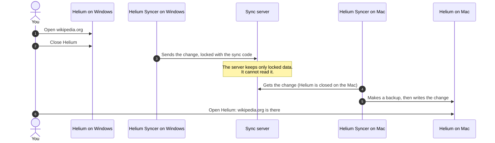
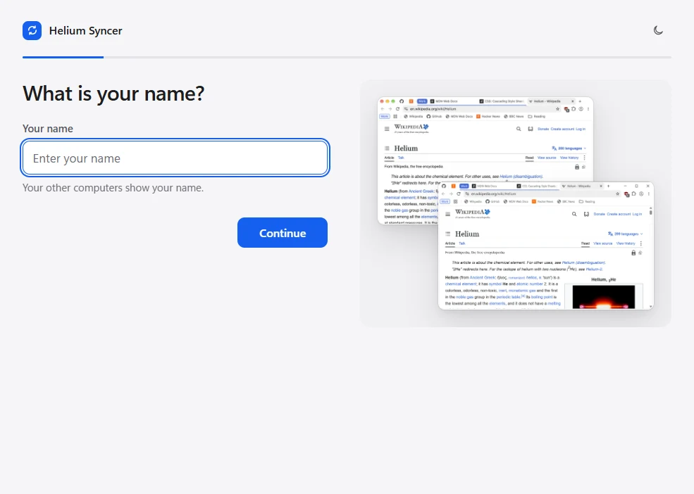
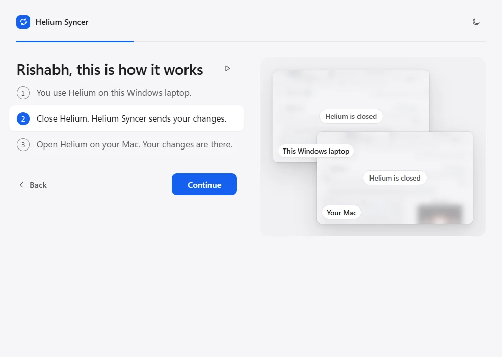
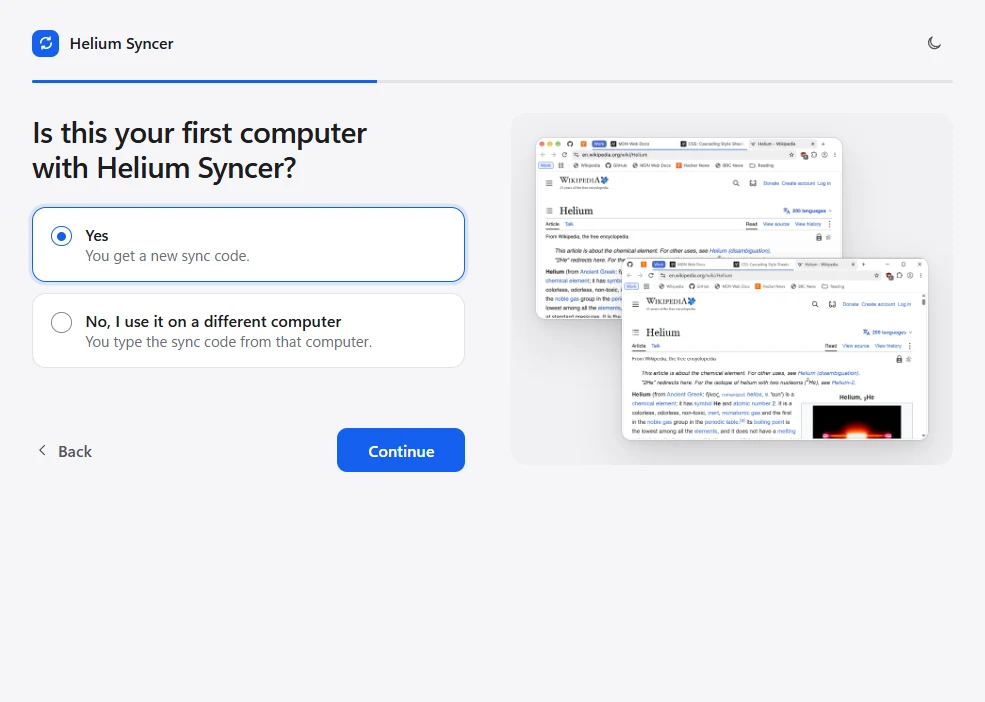
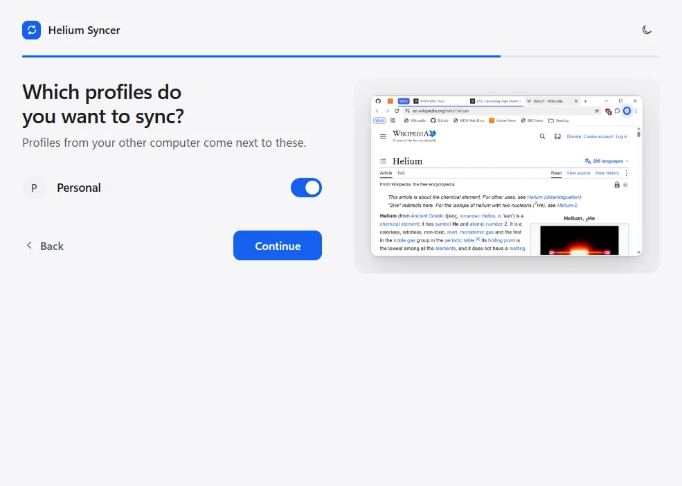
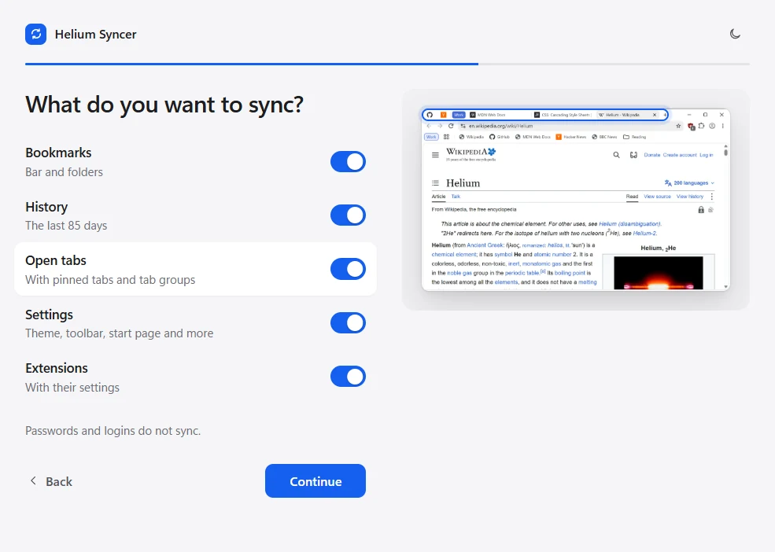
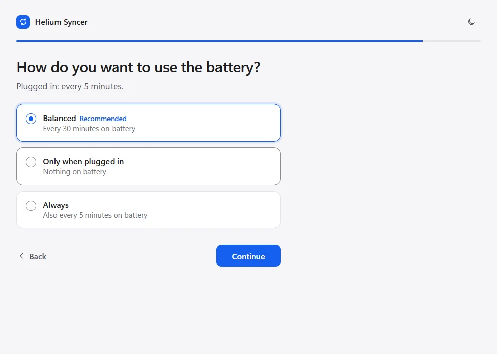
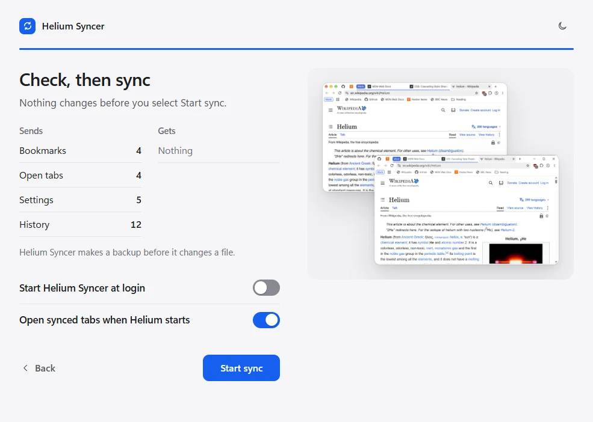
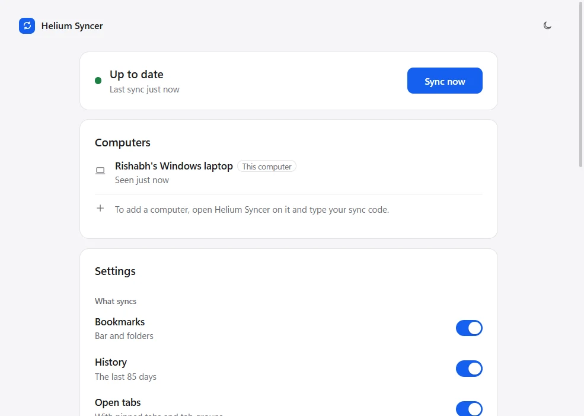

# Helium Syncer

**Use the same Helium browser on your Mac and your Windows computer.**
Your bookmarks, open tabs, tab groups, history, profiles, settings and extensions sync between your computers.

> [!IMPORTANT]
> **Helium Syncer is not part of the [Helium](https://helium.computer) browser project.**
> The Helium team and imput did not make it. They do not support it and they do not pay for it.
> Helium Syncer is a free hobby project. It helps people who use Helium on more than one computer.
> We use the name "Helium" only to tell you which browser this tool works with.

> [!WARNING]
> **Early version. Do not use it for important data yet.**
> The tests pass on Windows and macOS, but real-computer tests continue. Watch or star this repository to see when it is ready.

---

## Contents

- [How it works](#how-it-works)
- [See it](#see-it)
- [What syncs](#what-syncs)
- [Set it up](#set-it-up)
- [Battery and speed](#battery-and-speed)
- [What you need](#what-you-need)
- [Your data is safe](#your-data-is-safe)
- [Privacy](#privacy)
- [Questions](#questions)
- [Build it yourself](#build-it-yourself)
- [Roadmap](#roadmap)
- [A short note from me](#a-short-note-from-me)

---

## How it works

**An example.** You have a Windows laptop at work and a Mac at home.

1. At work, you open `wikipedia.org` in Helium.
2. You close Helium. Helium Syncer locks the change with your sync code and sends it.
3. At home, Helium is closed. Helium Syncer on the Mac gets the change and writes it into Helium.
4. You open Helium on the Mac. `wikipedia.org` is open there too.



**Three rules that never change:**

- Helium Syncer syncs **only when Helium is closed**. While you use Helium, nothing changes under you.
- Helium Syncer **never deletes your data**. Profiles from your other computer come next to your profiles.
- Before each change, Helium Syncer **makes a backup**.

On a Mac, "close Helium" means **Command + Q**. A closed window is not enough.

## See it

The setup takes a few minutes. These are the real screens of the app window, with test data. The pictures inside them are real Helium windows.

<table>
<tr><td valign="top"><br>1. Type your name.</td><td valign="top"><br>2. See how it works, in 3 steps.</td></tr>
<tr><td valign="top"><br>3. Start a new sync, or join one.</td><td valign="top"><br>4. Select your profiles.</td></tr>
<tr><td valign="top"><br>5. Select what syncs. The real Helium window shows each item.</td><td valign="top"><br>6. On a laptop, select a battery mode.</td></tr>
<tr><td valign="top"><br>7. Check what changes. Nothing changes before you agree.</td><td valign="top"><br>8. Home: status, computers and settings.</td></tr>
</table>

## What syncs

You can switch each item on or off, on each computer.

| Item | What happens |
|---|---|
| **Bookmarks** | The bookmarks bar and all folders. A bookmark that you delete on one computer is deleted on the other. |
| **History** | Pages that you opened in the last 85 days, from all your computers. |
| **Open tabs** | Open tabs, pinned tabs and tab groups. Helium Syncer puts them together without copies. A tab that you close stays closed. |
| **Settings** | Start page, toolbar, theme, fonts, languages and privacy switches. Not the download folder or window sizes. |
| **Extensions** | Helium Syncer installs your extensions on the other computer, with their settings (for example, your blocker rules). |
| **Profiles** | Always on. A profile from your other computer is added next to your profiles. If two profiles have the same name, the new one gets a number, for example "Personal (2)", on this computer only. |

**What does not sync:**

| Item | Why |
|---|---|
| Passwords | Use a password manager, for example 1Password or Bitwarden. |
| Site logins (cookies) | Not yet. A later version adds this, only for sites that you select. Google, Microsoft, Apple and bank sites stay locked, because a login that moves can lock your account. |

## Set it up

> [!NOTE]
> There is no download yet. To try Helium Syncer now, [build it yourself](#build-it-yourself).

**On your first computer:**

1. Install [Helium](https://helium.computer). Open Helium one time. Then close Helium.
2. Open **Helium Syncer**. It opens in its own window.
3. Type your name. Helium Syncer shows how it works in 3 steps.
4. Select **Yes**. Save your **sync code** in your password manager.
5. Select what you want to sync and which profiles.
6. Read the check. Nothing changes before you select **Start sync**.

**On each other computer:**

1. Install Helium and Helium Syncer.
2. Open Helium Syncer. Type your name.
3. Select **No, I use it on a different computer**. Type your sync code.
4. Read the check. Then select **Start sync**.

Each step has a **Back** button.

After this, Helium Syncer works by itself. It shows an icon next to the clock (Windows) or in the menu bar (Mac):

| Icon | Meaning |
|---|---|
| 🔵 Blue | All is good. |
| 🟠 Orange | Helium Syncer needs you. Open its menu to see why. |

## Battery and speed

Helium Syncer does very little while it waits. We measured it on Windows 11:

| | Measured |
|---|---|
| Processor time while it waits | **about 1 second in 1 hour** (about 0.03 %) |
| Memory | **about 21 MB** |

On a laptop, you select how Helium Syncer uses the battery:

| Mode | Plugged in | On battery | Low battery (20 % or less) or battery saver |
|---|---|---|---|
| **Balanced** (recommended) | A check every 5 minutes | A check every 30 minutes | Only one sync after you close Helium |
| **Only when plugged in** | A check every 5 minutes | Nothing. Your changes wait. | Nothing |
| **Always** | A check every 5 minutes | A check every 5 minutes | A check every 5 minutes |

In all modes:

- **Sync now** always works.
- A sync runs at low priority, so your computer stays quiet. On Windows, Helium Syncer also uses the Windows efficiency mode.
- To know if Helium is open, Helium Syncer does one small file check every 5 seconds (every 15 seconds on battery).

## What you need

| | Windows | Mac |
|---|---|---|
| **System** | Windows 10 or Windows 11 | macOS 12 Monterey or newer |
| **Processor** | 64-bit Intel or AMD, or ARM | Apple silicon (M1 and newer) or Intel |
| **Memory** | 4 GB or more (Helium Syncer uses about 21 MB) | 4 GB or more |
| **Helium** | Any install type: for you only or for all users | Any folder, for example Applications |
| **Other software** | **None.** No PowerShell version, no admin rights, no extra installs. | **None.** No Homebrew, no admin rights. |

Helium Syncer is one program with everything inside it. It finds Helium by itself. If Helium is in an unusual place, the window lets you select the Helium data folder.

If Helium is not installed, the window tells you. It gives you a button to get Helium.

## Your data is safe

- **A backup before each change.** If a sync stops in the middle (for example, a power cut), the next start puts everything back.
- **Never while Helium is open.** Helium Syncer checks again when each sync starts. If Helium is open, it waits.
- **A check before the first sync.** You see what will change. Nothing changes before you agree.
- **Helium updates.** If your computers have different Helium versions that we did not test together, Helium Syncer stops and tells you to update Helium. It does not guess.
- **Tested.** 68 groups of automatic tests, with many random cases. Many tests use a real Helium browser on Windows and macOS. We also break the code on purpose to make sure that the tests find the problem.

## Privacy

- **Locked on your computer.** Helium Syncer locks (encrypts) your data before it leaves your computer. The server keeps only locked data. Nobody else can read it. We also cannot.
- **No account.** There is no email and no password. Your sync code is the only key. The server never gets the code.
- **Keep your sync code safe.** A person with your code can join your sync. If you lose the code, nobody can get it back for you.
- **What the server knows:** your computer names, your Helium versions and the size of your locked data.
- **No tracking.** The app sends nothing else. It uses no web fonts and no analytics.
- **Self-hosting.** You can run the server on your own Cloudflare account.
- **Open source.** All the code is in this repository, under the MIT license.

## Questions

**I lost my sync code. What do I do?**
On a computer that still syncs, open Helium Syncer. Go to **Settings**. Select **Show** next to **Sync code**.

**Both computers have Helium open. What happens?**
Nothing changes while Helium is open. When you close Helium on each computer, Helium Syncer puts the tabs from both computers together. It makes no copies.

**I closed a tab on one computer. Does it come back?**
No. A tab that you close stays closed on all your computers.

**Can I stop syncing on one computer?**
Yes. Go to **Settings** and select **Leave**. Your Helium data stays on that computer.

**How do I remove Helium Syncer?**
1. In Helium Syncer, go to **Settings** and select **Leave**.
2. Quit Helium Syncer from its icon menu.
3. Delete the app.
4. Optional: delete its folder. Windows: `%APPDATA%\Helium Syncer`. Mac: `~/Library/Application Support/Helium Syncer`.

Your Helium data stays as it is.

**Does Helium Syncer read my passwords?**
No. Helium Syncer does not read or sync passwords.

## Build it yourself

You need [Go](https://go.dev/dl/). The build scripts get the correct Go version (1.26.10) by themselves. Go 1.26 makes programs that run on macOS 12 and Windows 10.

**Mac** (you also need the Xcode command line tools: `xcode-select --install`):

```bash
sh scripts/build-app.sh
```

This makes `bin/Helium Syncer.app`. It works on Apple silicon and Intel Macs.

**Windows** (works with Windows PowerShell 5.1 and PowerShell 7):

```powershell
powershell -ExecutionPolicy Bypass -File scripts/build-app.ps1
```

This makes `bin\Helium Syncer.exe` (64-bit Intel and AMD) and `bin\arm64\Helium Syncer.exe` (ARM).

There is also a command-line tool for advanced users. Type `helium-syncer help` to see its commands.

**Help with tests.** Do you have Helium on a Mac or a Windows computer? These scripts show where Helium keeps its data. They do not show secrets and they do not change Helium. They save a short report on your Desktop and copy it, so that you can send it to us.

```bash
curl -fsSL https://raw.githubusercontent.com/imrishabhchauhan/helium-syncer/main/scripts/check-mac.sh | bash
```

```powershell
irm https://raw.githubusercontent.com/imrishabhchauhan/helium-syncer/main/scripts/check-windows.ps1 | iex
```

## Roadmap

- [x] **Step 0:** Read and write each Helium data type safely, on test profiles (Windows and macOS).
- [x] **Step 1:** Sync code, encryption, server, profiles, bookmarks, history, tabs, pinned tabs, tab groups, settings, extensions.
- [x] **Step 2:** Setup window, tray and menu-bar app, battery modes, on/off switch for each item.
- [ ] **Step 3:** Real tests between a Mac and a Windows computer. *(now)*
- [ ] **Step 4:** Site logins, only for sites that you select.
- [ ] **Step 5:** Signed installers, automatic updates and a self-hosting guide.

The full design is in [docs/01-spec.md](docs/01-spec.md).

## A short note from me

I love the official Helium browser. It is fast, simple and private. It is the browser that I want to use each day.

Helium does not have sync yet. I work on a Mac and on a Windows computer, so for my work I need sync. So I made this tool with [Claude Code](https://claude.com/claude-code) 🙂

When the Helium team adds sync ([imputnet/helium#90](https://github.com/imputnet/helium/issues/90)), I will archive this project. Until then, enjoy.

— [Rishabh Chauhan](https://aiwithrishabh.com)

## License

[MIT](LICENSE) © 2026 Rishabh Chauhan
